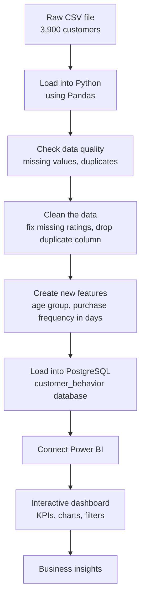

# Customer Shopping Behavior Analysis

## The Problem

A retail company noticed that its customers' buying habits were changing, but it didn't know why. Which customers spend the most? Do discounts, reviews, or shipping options affect what people buy? Without clear answers, it was hard to plan marketing, pricing, or stock.

## The Solution

I took the company's shopping data (3,900 customers, 18 columns) and built a simple pipeline to answer those questions:

- **Python** cleans the data and creates useful new columns
- **PostgreSQL** stores the clean data in one reliable place
- **Power BI** turns it into an interactive dashboard that anyone can filter and explore, with no coding needed

## Workflow



**In short:**

1. **Clean:** I found 37 missing review ratings and dropped a duplicate column (`promo_code_used`, which matched `discount_applied` exactly).
2. **Add features:** I grouped customers into age groups and turned purchase frequency (weekly, monthly...) into number of days.
3. **Store:** I loaded the clean data into a PostgreSQL database.
4. **Visualize:** I built a dashboard with filters for gender, category, shipping type, and subscription status.

## What's Inside

| File | What it does |
|---|---|
| `Customer_Shopping_Behavior_Analysis.ipynb` | Cleans the data, builds new features, and loads it into PostgreSQL |
| `customer_behavior_dashboard.pbix` | The Power BI dashboard |
| `customer_shopping_behavior.csv` | The original dataset |

## What I Found

- Average purchase: **$59.76**
- Average review rating: **3.75 / 5**
- Clothing sells the most, in both revenue and volume
- Young adults and middle-aged customers spend the most
- Only **27%** of customers are subscribers, so there's room to grow

## How to Run This Repository

**You'll need:** Python 3, Jupyter Notebook, PostgreSQL, and Power BI Desktop.

**1. Clone the repository**
```bash
git clone https://github.com/namanjain82670-prog/<your-repo-name>.git
cd <your-repo-name>
```

**2. Install the libraries**
```bash
pip install pandas numpy sqlalchemy psycopg2-binary jupyter
```

**3. Create the database**

Open pgAdmin (or `psql`) and run:
```sql
CREATE DATABASE customer_behavior;
```

**4. Run the notebook**

Open `Customer_Shopping_Behavior_Analysis.ipynb`, update the database username and password in the connection cell, and run all cells. This cleans the data and creates a `customer` table in PostgreSQL.

**5. Open the dashboard**

Open `customer_behavior_dashboard.pbix` in Power BI Desktop, connect it to your PostgreSQL database if asked, and click **Refresh**.

## Built With

Python · Pandas · PostgreSQL · Power BI · Jupyter Notebook
